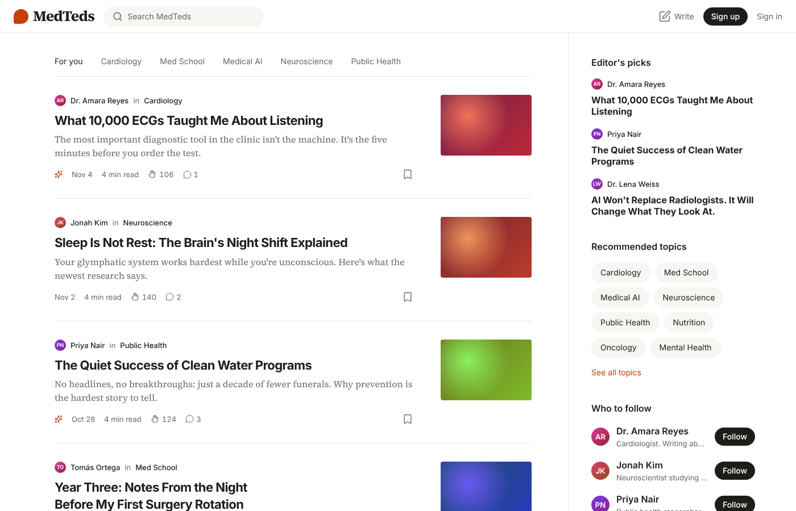

# MedTeds

A blogging platform for stories about medicine and health. Anyone can sign up, write and publish; readers can clap, respond, follow writers and save stories; editors run the site from an admin area.



## Stack

| Part | Choice |
|---|---|
| Framework | Next.js 16 (App Router) with TypeScript |
| Styling | Tailwind CSS 4 with MedTeds design tokens |
| Components | Own component library in `src/components/ui` (shadcn-style, built with `class-variance-authority`) |
| Database | PostgreSQL with Drizzle ORM (works with Supabase, Neon or any Postgres) |
| Sign-in | Better Auth: email and password, plus optional Google |
| Editor | Tiptap |
| Images | Stored in Postgres by default, or in Supabase Storage when configured |

## Roles

Modelled on WordPress. Admins change roles in **Admin → Users**.

| Role | Can do |
|---|---|
| Subscriber | Read, clap, respond, save and follow. Everyone who signs up starts here. |
| Contributor | Write drafts and submit them for review. Can't publish. |
| Author | Write and publish their own stories, and upload images. |
| Editor | Manage everyone's stories, pages, media, topics, SEO and responses. |
| Administrator | Everything, plus users, menus and site settings. |

The rules live in `src/lib/permissions.ts`.

## Pages

**Readers**

| Page | Path |
|---|---|
| Home feed: "For you" (followed topics and writers first), Following, and a scrolling topic bar | `/` |
| Story | `/p/[slug]` |
| Writer profile | `/@username` |
| Topic page with Follow, and Explore topics | `/tag/[slug]`, `/topics` |
| Pick your interests (after sign-up) | `/welcome/topics` |
| Notifications: claps, responses, replies, new followers, new stories from writers you follow | `/notifications` |
| Library: your lists, saved lists, highlights, reading history | `/library` |
| A reading list (private, or public on your profile) | `/list/[id]` |
| Search (stories, people, topics) | `/search?q=` |
| Reading list (the default list) | `/reading-list` |
| Pages from the CMS (About, Privacy, Terms, any new page) | `/[page]` |
| Sign in, sign up, forgot/reset password, accept invitation | `/signin`, `/signup`, `/forgot-password`, `/reset-password`, `/invite/[token]` |

**Writers**

| Page | Path |
|---|---|
| New story | `/write` |
| Editor: autosave, images (upload or library), topics, cover, schedule, revisions, and an **SEO** panel (web address, search title and description, Google and social previews, checklist, hide from search, canonical URL) | `/editor/[id]` |
| Your stories: drafts, published, trash | `/me/stories` |
| Settings: profile, photo, theme, password | `/settings` |

**Admin** (Editors and Administrators)

| Section | What it does |
|---|---|
| Dashboard `/admin` | At-a-glance counts, views per day, top stories, review queue, responses to approve, quick draft |
| Posts `/admin/stories` | All / Published / Scheduled / Pending / Drafts / Trash / Editor's picks tabs, author and topic filters, search, bulk publish, unpublish, trash, restore, delete |
| Media `/admin/media` | Image library: upload by drag and drop, alt text, copy link, where each image is used, delete |
| Pages `/admin/pages` | Create and edit pages like About and Privacy |
| SEO `/admin/seo` | Every story and page with its search title, description and score. Filter by "needs attention", edit any listing, reset to automatic, hide from search in bulk. Also topic listings, the home page listing, title separator, default sharing image, Google Search Console and sitemap links |
| Reports `/admin/reports` | Stories and responses readers reported: move a story to trash, mark a response as spam, resolve or dismiss |
| Comments `/admin/comments` | Approve, unapprove, spam or delete responses, one by one or in bulk |
| Topics `/admin/topics` | Add, edit and delete topics |
| Users `/admin/users` | Invite by email with a role, change roles, suspend, edit profiles, create password-reset links, delete with story reassignment |
| Menus `/admin/menus` | Header and footer links |
| Settings `/admin/settings` | Site name, tagline, logo, brand colour, social links, open or closed sign-up, response approval rules |

## SEO

SEO works automatically: each story's search title comes from its title, the description from its subtitle or opening lines, and the sharing image from its cover (or the site default). The rules are in `src/lib/seo-auto.ts`. Editors and Administrators can override any of it in the story's SEO panel or in **Admin → SEO**; a blank field means automatic.

- Every story and page gets a canonical link, Open Graph and X (Twitter) sharing tags, and stories also get Article structured data for Google.
- `/sitemap.xml` lists live stories, pages, topics and writers. `/robots.txt` points to it and keeps private areas out of search. `/feed.xml` is an RSS feed of the latest 30 stories.
- Stories and pages can be hidden from search individually; Admin → SEO → Site can hide the whole site.
- To get listed on Google, verify the site in Google Search Console (paste the code in Admin → SEO → Site) and submit `/sitemap.xml`.

Scheduled stories go live at their publish time automatically; no background job is needed. Trashed stories are deleted for good after 30 days.

## Reading features

- **Saving:** the bookmark icon saves to the reading list on the first click and opens a menu to add the story to other lists or start a new one.
- **Highlights:** select text in a story to highlight it, quote it in a response, or copy it with a link. A passage highlighted by 3 or more readers shows to everyone as the top highlight.
- **Responses:** reply to a response (one level deep), and clap for responses.
- **Mute and report:** the "…" menu on a story mutes the writer or topic, or reports the story. Muted writers and topics disappear from feeds, the topic bar, the sidebar and search; readers can unmute them in Settings.

## Run it locally

You need Node.js 20+ and a PostgreSQL database.

1. Install packages:

   ```bash
   npm install
   ```

2. Copy the settings file and fill it in:

   ```bash
   cp .env.example .env
   ```

   Set `DATABASE_URL` to your database and `BETTER_AUTH_SECRET` to a random string (`openssl rand -base64 32`).

3. Create the tables:

   ```bash
   npm run db:migrate
   ```

4. Optional: add sample topics, writers and stories:

   ```bash
   npm run db:seed
   ```

   Sample accounts use the password `medteds-demo`. `admin@medteds.local` is an admin; writers include `amara@medteds.local`.

5. Start the app at http://localhost:3000:

   ```bash
   npm run dev
   ```

### Making someone an admin

Emails listed in `ADMIN_EMAILS` become admins when they sign up (or on their next visit, if they already have an account). After that, admins invite people and change roles from **Admin → Users**.

### Email (optional)

Set `RESEND_API_KEY` and `EMAIL_FROM` to email invitations and password-reset links. Without them, the admin area shows each link so you can send it yourself.

## Deploy (Vercel + Supabase)

1. Create a Supabase project. Copy its database connection string (Project Settings → Database → Session pooler URI).
2. Run the migrations against it once: `DATABASE_URL="<supabase uri>" npm run db:migrate`.
3. Optional: create a public Storage bucket called `media` and set `SUPABASE_URL` and `SUPABASE_SERVICE_ROLE_KEY` so uploaded images go to Supabase Storage instead of the database.
4. Import the repository in Vercel and add the variables from `.env.example`. Set `BETTER_AUTH_URL` and `NEXT_PUBLIC_APP_URL` to your site's address.
5. For Google sign-in, create OAuth credentials in Google Cloud with the redirect URL `https://<your-site>/api/auth/callback/google`, then set `GOOGLE_CLIENT_ID` and `GOOGLE_CLIENT_SECRET`.

## Design system

All colours, fonts, sizes, corner rounding and shadows are tokens in `src/app/globals.css`, with light and dark values. Tailwind classes use the token names, for example `bg-surface`, `text-muted`, `border-line`, `bg-accent`, `rounded-pill`, `shadow-card`. Change the brand colour by editing `--accent`.

| Folder | What's in it |
|---|---|
| `src/components/ui` | Building blocks: Button, Input, Textarea, Select, Field, Chip, Badge, Avatar, Cover, Tabs, EmptyState, Logo |
| `src/components/blog` | Reader features: TopBar, StoryCard, Sidebar, ClapButton, BookmarkButton, FollowButton, Comments, ThemeToggle |
| `src/components/cms` | Writer tools: StoryEditor, PageEditor, MediaBrowser and picker, RevisionsDialog, ProfileForm, upload helper |
| `src/components/admin` | Admin navigation, posts table, comment queue, views chart, menu, settings and user forms |

Open `/design` in the running app to see every component in light and dark.

## Project layout

```
src/
  app/            Pages and API routes
  components/     UI, blog, CMS and admin components
  db/             Drizzle schema and database client
  lib/            Auth, permissions, settings, queries (reads), actions (writes), content rendering, storage
  proxy.ts        Sends signed-out visitors to sign in before private pages
drizzle/          SQL migrations
scripts/seed.ts   Sample data
```

## Scripts

| Command | What it does |
|---|---|
| `npm run dev` | Start the development server |
| `npm run build` / `npm start` | Production build and server |
| `npm run lint` / `npm run typecheck` | Code checks |
| `npm run db:generate` | Create a migration after changing `src/db/schema.ts` |
| `npm run db:migrate` | Apply migrations |
| `npm run db:seed` | Add sample data to an empty database |
| `npm run db:studio` | Browse the database in Drizzle Studio |

## Known issue

In production builds, opening a page that contains the theme switch (`/settings`, `/design`) by typing its address, straight after another page in the same tab, can log a React hydration warning (#418) in the browser console. React recovers on its own and the page works normally. The cause hasn't been pinned down yet.
